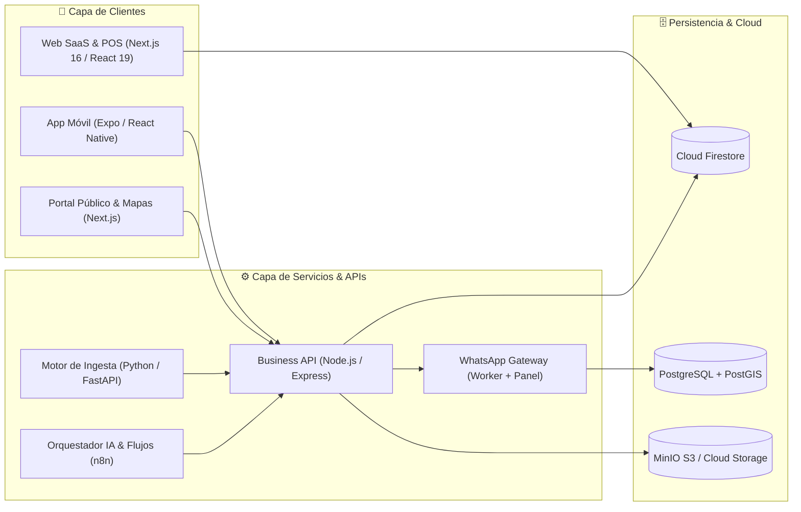

<div align="center">
  

  <br />

  <p align="center">
    <a href="https://github.com/serf03">
      
    </a>
    
    
    <a href="mailto:ismaelaybar53@gmail.com">
      
    </a>
  </p>
</div>

---

### `>_` Perfil de Ingeniería

Soy **Ismael Aybar** (`@serf03`), desarrollador y arquitecto de software **Full-Stack** enfocado en diseñar, construir y escalar productos digitales completos de extremo a extremo: desde aplicaciones móviles nativas y paneles web de alta velocidad hasta APIs distribuidas, motores de extracción de datos (scraping) y pasarelas de mensajería automatizadas.

- 🏗️ **Diseño de Sistemas en Producción:** Desarrollo ecosistemas multi-servicio que combinan **Next.js / React**, **Expo (React Native)**, **Node.js** y **Python (FastAPI)**.
- 💳 **Sistemas Comerciales (POS & Finanzas):** Creación de plataformas de punto de venta en tiempo real, facturación, control de inventario multi-sucursal y gestión presupuestaria.
- 🗺️ **Ecosistemas PropTech & Geolocalización:** Mapas interactivos de alto rendimiento, clustering geoespacial (**PostGIS** / Google Maps), e ingesta automatizada de catálogos inmobiliarios.
- 🤖 **Automatización e Integraciones:** Orquestación de flujos de negocio con **n8n**, gateways propios de **WhatsApp**, validación criptográfica JWT y almacenamiento en la nube.

---

### `🛠️` Stack Tecnológico & Herramientas

#### **Lenguajes & Core**
<p align="left">
  
  
  
  
  
  
</p>

#### **Frontend, Web & Mobile**
<p align="left">
  
  
  
  
  
  
  
  
</p>

#### **Backend, APIs & Automatización**
<p align="left">
  
  
  
  
  
  
</p>

#### **Bases de Datos, Cloud & DevOps**
<p align="left">
  
  
  
  
  
  
  
</p>

---

### `🏗️` Ecosistemas y Productos en Producción

<table>
  <tr>
    <td width="50%" valign="top">
      <h4>💳 PosQc — Plataforma SaaS de Punto de Venta (POS)</h4>
      <p>Sistema integral de punto de venta, facturación, inventario en tiempo real, analítica financiera y control operativo diseñado para comercios modernos.</p>
      <ul>
        <li><b>Arquitectura:</b> Next.js 16 (App Router), React 19, TypeScript, Zustand y validación estricta con Zod.</li>
        <li><b>Infraestructura:</b> Sincronización en tiempo real con Cloud Firestore, reglas de seguridad avanzadas y Google Cloud Storage.</li>
        <li><b>Capacidades:</b> Reportes Excel estilizados, generación de QR, pasarelas de pago y suite de pruebas de regresión automatizadas.</li>
      </ul>
      <p>
        <code>TypeScript</code> <code>Next.js 16</code> <code>Firebase</code> <code>Tailwind</code> <code>Jest</code>
      </p>
    </td>
    <td width="50%" valign="top">
      <h4>🏢 MapRent / SuperRenta — Ecosistema PropTech</h4>
      <p>Plataforma inmobiliaria distribuida para el descubrimiento, publicación y gestión de alquileres basada en mapas interactivos y geolocalización avanzada.</p>
      <ul>
        <li><b>App Móvil & Web:</b> Cliente nativo en <b>Expo / React Native</b> con clustering de mapas y portal público en <b>Next.js</b>.</li>
        <li><b>Backend & Datos:</b> API de negocio en <b>Node.js / Express</b>, almacenamiento de medios en <b>MinIO</b> y base geoespacial <b>PostgreSQL / PostGIS</b>.</li>
        <li><b>Ingesta & Mensajería:</b> Microservicio en <b>Python / FastAPI</b> para scraping/normalización y <b>WhatsApp Gateway</b> propio para OTP y alertas.</li>
      </ul>
      <p>
        <code>React Native</code> <code>Node.js</code> <code>FastAPI</code> <code>PostGIS</code> <code>MinIO</code>
      </p>
    </td>
  </tr>
  <tr>
    <td width="50%" valign="top">
      <h4>📊 Prosup & Alquiler 4.0 — Gestión Financiera e Inmobiliaria</h4>
      <p>Suite de aplicaciones orientadas a la planificación financiera personal, control de presupuestos, cuentas y administración automatizada de contratos de alquiler.</p>
      <ul>
        <li><b>Arquitectura:</b> Aplicaciones full-stack reactivas con paneles de métricas, proyecciones de flujo de caja y alertas inteligentes.</li>
        <li><b>Enfoque UX:</b> Interfaces de alta legibilidad, navegación fluida y soporte multi-dispositivo.</li>
      </ul>
      <p>
        <code>TypeScript</code> <code>Next.js</code> <code>Firebase</code> <code>Recharts</code>
      </p>
    </td>
    <td width="50%" valign="top">
      <h4>🤖 Automatización, Gateways & Geo-Servicios</h4>
      <p>Infraestructura transversal para conectar servicios, procesar datos públicos/geográficos y automatizar operaciones empresariales.</p>
      <ul>
        <li><b>ARK WhatsApp Gateway:</b> Transporte privado con worker en Express, panel administrativo en Next.js y persistencia en Postgres.</li>
        <li><b>GeoRd & RNC Services:</b> Herramientas en Python y TypeScript para procesamiento geográfico, consultas tributarias y flujos en <b>n8n</b>.</li>
      </ul>
      <p>
        <code>Python</code> <code>Docker</code> <code>n8n</code> <code>Express</code> <code>PostgreSQL</code>
      </p>
    </td>
  </tr>
</table>

---

### `📐` Arquitectura de Referencia (Ecosistema Multi-Servicio)



---

### `⚡` Estándares de Ingeniería que Aplico

```ts
const principiosDeIngenieria = {
  arquitectura: "Modular, tipado estricto de extremo a extremo (TypeScript + Zod) y separación clara de dominios",
  seguridad: "Autenticación JWT, reglas de seguridad granulares en Firestore y validación server-side",
  rendimiento: "Optimización de renders en React 19, consultas geoespaciales indexadas y carga diferida",
  operaciones: "Contenedores Docker, automatización de despliegues y flujos resilientes"
};
```

---

<div align="center">
  <sub>⚡ Diseñado y mantenido por <b>Ismael Aybar (@serf03)</b> — Construyendo software robusto desde República Dominicana 🇩🇴</sub>
</div>
