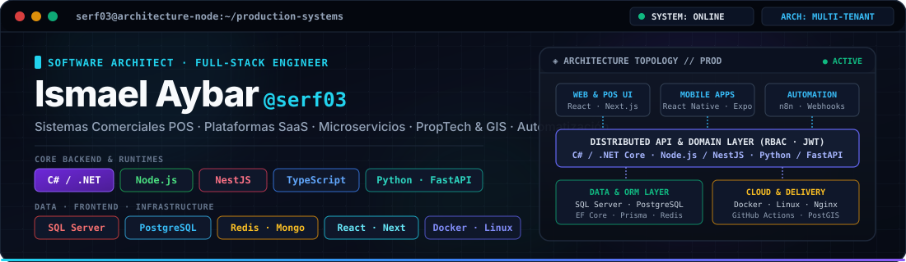

<div align="center">

<!-- =========================
     HERO & ARCHITECTURE BANNER
========================= -->



<br />

<p>
Diseño y construyo productos digitales de extremo a extremo:
<strong>POS, SaaS, sistemas distribuidos, automatización, facturación, GIS y plataformas comerciales.</strong>
</p>

<p>
  
  
  
</p>

</div>

---

## `> whoami`

```ts
const engineer = {
  name: "Ismael Aybar",
  handle: "@serf03",
  role: "Software Architect / Full-Stack Engineer",

  backend: ["C#", ".NET", "Node.js", "NestJS", "Python", "FastAPI"],
  frontend: ["TypeScript", "React", "Next.js", "React Native", "Expo"],

  data: [
    "SQL Server",
    "PostgreSQL",
    "MongoDB",
    "Redis",
    "Prisma",
    "Entity Framework Core"
  ],

  infrastructure: [
    "Docker",
    "Linux",
    "Nginx",
    "GitHub Actions",
    "CI/CD",
    "VPS / Cloud"
  ],

  architecture: [
    "Microservices",
    "Multi-tenant SaaS",
    "REST APIs",
    "Real-time Systems",
    "RBAC",
    "Event-driven workflows"
  ]
};
```

---

# ⚙️ Engineering Stack

<div align="center">

### Backend

<p>
  
</p>

### Frontend

<p>
  
</p>

### Data & Persistence

<p>
  
  &nbsp;
  
  
</p>

### Infrastructure & Delivery

<p>
  
</p>

</div>

---

# 🧠 What I Build

<table>
<tr>
<td width="50%" valign="top">

### 🧾 POS & Retail Systems

Sistemas comerciales orientados a operación real:

- Ventas y facturación
- Inventario multi-sucursal
- Clientes y cuentas por cobrar
- Deudas y pagos parciales
- Roles y permisos
- Reportes y métricas
- Integraciones externas

</td>

<td width="50%" valign="top">

### 🍽️ Restaurant Platforms

Flujos completos de restaurante:

- Mesas y camareros
- Comandas por asiento
- Modificadores y extras
- Cocina / KDS
- Rondas y estados
- Caja y cierre de mesa
- Validación de precios en backend

</td>
</tr>

<tr>
<td width="50%" valign="top">

### 🏙️ PropTech & GIS

Plataformas orientadas a datos geoespaciales:

- Mapas interactivos
- PostgreSQL / PostGIS
- Clustering geográfico
- Scraping de catálogos
- Procesamiento de datos
- APIs de búsqueda y localización

</td>

<td width="50%" valign="top">

### 🤖 Automation & Integrations

Automatización de procesos de negocio:

- n8n
- Webhooks
- WhatsApp gateways
- Jobs y procesos asíncronos
- Integraciones con APIs
- JWT y validación criptográfica
- Flujos operativos automatizados

</td>
</tr>
</table>

---

# 🏗️ Architecture Mindset

```text
                    ┌───────────────────────┐
                    │     WEB / MOBILE      │
                    │ React · Next · Expo   │
                    └───────────┬───────────┘
                                │
                                ▼
                    ┌───────────────────────┐
                    │      API LAYER        │
                    │ .NET · Node · FastAPI │
                    └───────────┬───────────┘
                                │
          ┌─────────────────────┼─────────────────────┐
          ▼                     ▼                     ▼
 ┌────────────────┐    ┌────────────────┐    ┌────────────────┐
 │ Sales / POS    │    │ Billing / Debt │    │ Identity / RBAC│
 └───────┬────────┘    └───────┬────────┘    └───────┬────────┘
         │                     │                     │
         └──────────────┬──────┴──────────────┬──────┘
                        ▼                     ▼
              ┌──────────────────┐   ┌──────────────────┐
              │ SQL / PostgreSQL │   │ MongoDB / Redis  │
              └─────────┬────────┘   └─────────┬────────┘
                        │                      │
                        └──────────┬───────────┘
                                   ▼
                        ┌───────────────────────┐
                        │ Docker · Linux · CI/CD│
                        └───────────────────────┘
```

> Me interesa que la arquitectura sea mantenible, observable y segura;  
> que las reglas críticas vivan en backend y que el cliente nunca sea la autoridad sobre datos sensibles.

---

# 🚀 Current Engineering Focus

```yaml
building:
  - multi-tenant SaaS platforms
  - advanced POS ecosystems
  - restaurant workflows
  - electronic billing integrations
  - debt intelligence & analytics
  - distributed backend services

principles:
  - backend-authoritative business rules
  - transactional consistency
  - modular architecture
  - secure API design
  - observability
  - automation-first workflows
```

---

# 🧩 Core Technologies

| Area | Technologies |
|---|---|
| **Backend** | C#, .NET, Node.js, NestJS, Python, FastAPI |
| **Frontend** | TypeScript, React, Next.js, React Native, Expo |
| **Databases** | SQL Server, PostgreSQL, MongoDB, Redis |
| **ORM / Data** | Entity Framework Core, Prisma |
| **Infra** | Docker, Linux, Nginx, GitHub Actions, VPS |
| **Architecture** | Microservices, Multi-tenant SaaS, REST, RBAC, Real-time |
| **Automation** | n8n, Webhooks, Messaging Gateways, Background Jobs |
| **Geo / Data** | PostGIS, geospatial processing, scraping pipelines |

---

# 📊 GitHub

<div align="center">


</div>

<div align="center">


</div>

---

# 🛰️ System Status

```text
STATUS          ████████████████████  ONLINE
FOCUS           SaaS · POS · Distributed Systems
BACKEND         C#/.NET · Node.js · Python
DATA            SQL Server · PostgreSQL · MongoDB · Redis
FRONTEND        TypeScript · React · Next.js
INFRASTRUCTURE  Docker · Linux · CI/CD
```

---

# 🤝 Contact

<div align="center">

[](https://github.com/serf03)
[](mailto:ismaelaybar53@gmail.com)

</div>

---

<div align="center">

### `BUILD SYSTEMS. SOLVE REAL PROBLEMS. SHIP TO PRODUCTION.`

<sub>Software architecture · Full-stack engineering · Product development</sub>

</div>
